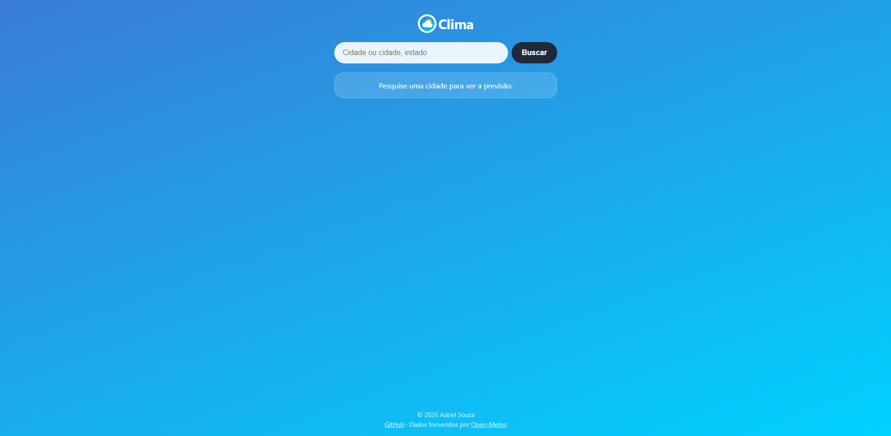
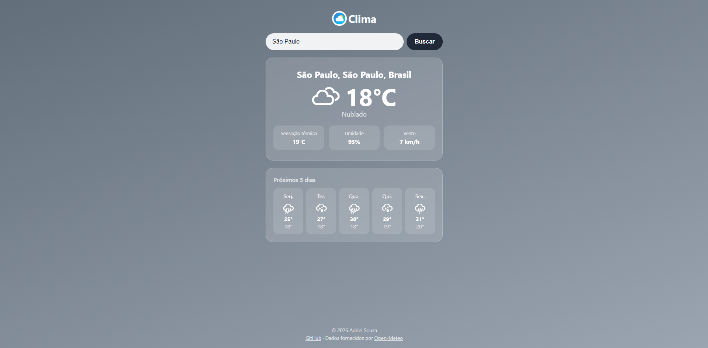
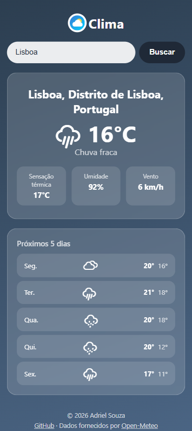

# Clima

**Aplicação online:** [Acessar Clima](https://weatherapp-five-ruddy.vercel.app/)

Aplicação web de previsão do tempo, desenvolvida com Vue 3 e JavaScript. Permite pesquisar cidades, consultar as condições meteorológicas atuais e acompanhar a previsão dos próximos cinco dias, com informações fornecidas pela API Open-Meteo.

## Funcionalidades

- Pesquisa de cidades por nome.
- Exibição da localização com cidade, estado/região e país.
- Consulta das condições meteorológicas atuais.
- Exibição da temperatura, sensação térmica, umidade e velocidade do vento.
- Previsão do tempo para os próximos cinco dias.
- Ícones meteorológicos de acordo com as condições climáticas.
- Fundo dinâmico que muda conforme a condição meteorológica atual.
- Armazenamento da última cidade pesquisada utilizando LocalStorage.
- Recuperação automática da última pesquisa ao abrir a aplicação.
- Tratamento de erros de pesquisa e conexão.
- Layout responsivo para dispositivos móveis.

## Capturas de tela

### Tela inicial



### Previsão do tempo



### Versão mobile



## Tecnologias

| Camada | Tecnologias |
|---|---|
| Front-end | Vue 3, JavaScript, HTML5, CSS3 |
| Ferramentas | Vite, npm |
| API | Open-Meteo Geocoding API e Forecast API |
| Ícones | Weather Icons |
| Armazenamento | LocalStorage |
| Hospedagem | Vercel |
| Controle de versão | Git, GitHub |

## Hospedagem

A aplicação está hospedada na Vercel e utiliza os serviços da Open-Meteo para obter informações meteorológicas.

- **Aplicação:** [Vercel](https://vercel.com/)
- **API meteorológica:** [Open-Meteo](https://open-meteo.com/)

Acesse a aplicação:

**[https://weatherapp-five-ruddy.vercel.app/](https://weatherapp-five-ruddy.vercel.app/)**

## Arquitetura

```text
Navegador
    |
    v
Vue 3
    |
    v
Serviços JavaScript
    |
    +----------------------+
    |                      |
    v                      v
Geocoding API          Forecast API
    |                      |
    +----------+-----------+
               |
               v
       Exibição dos dados
```

### Comunicação e processamento

- O usuário pesquisa uma cidade pela interface da aplicação.
- O serviço `weatherService.js` consulta a API de geolocalização da Open-Meteo para obter as coordenadas da cidade.
- Com as coordenadas, é realizada uma consulta à API de previsão meteorológica.
- Os dados recebidos são organizados e disponibilizados para os componentes Vue.
- O serviço `weatherCodes.js` interpreta os códigos meteorológicos WMO e associa descrições e ícones às condições climáticas.
- A última cidade pesquisada com sucesso é armazenada no LocalStorage.

## Como executar localmente

### Pré-requisitos

- Node.js.
- npm.
- Git.

### 1. Clone o repositório

```bash
git clone https://github.com/adrielsouzadev/weatherapp.git
cd weatherapp
```

### 2. Instale as dependências

```bash
npm install
```

### 3. Inicie a aplicação

```bash
npm run dev
```

A aplicação estará disponível em:

`http://localhost:5173`

## Decisões técnicas

- **Vue 3:** utilizado para construir a interface por meio de componentes reutilizáveis e reativos.
- **Vite:** responsável pelo ambiente de desenvolvimento e pela geração da versão de produção.
- **Open-Meteo:** utilizada para consultar a localização das cidades e obter dados meteorológicos, sem necessidade de chave de API.
- **Weather Codes (WMO):** utilizados para interpretar as condições meteorológicas retornadas pela API e exibir descrições e ícones correspondentes.
- **LocalStorage:** utilizado para salvar a última cidade pesquisada e recuperá-la ao abrir a aplicação.
- **CSS responsivo:** utilizado para adaptar a interface a diferentes tamanhos de tela.
- **Fundo dinâmico:** a aparência da aplicação é alterada de acordo com a condição meteorológica atual.

## Autor

Desenvolvido por **Adriel Souza**.

[GitHub](https://github.com/adrielsouzadev) · [LinkedIn](https://linkedin.com/in/adriel-souza-dev)